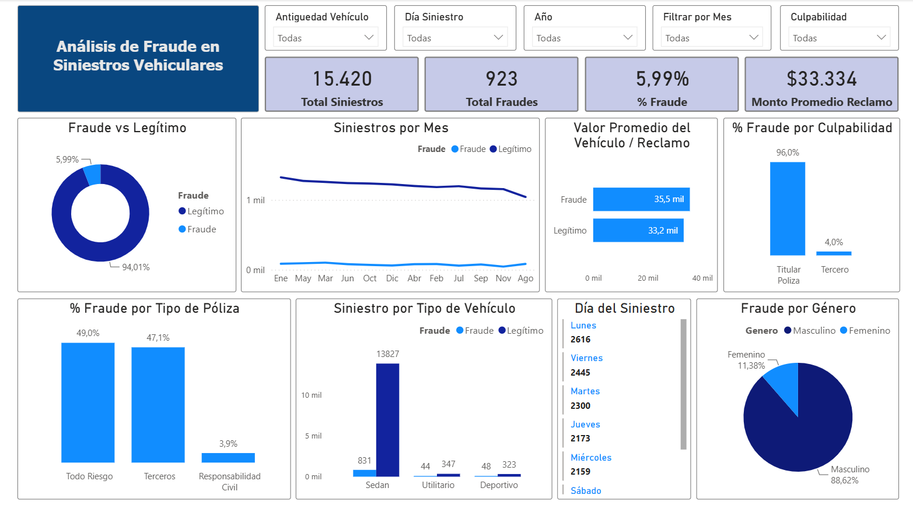
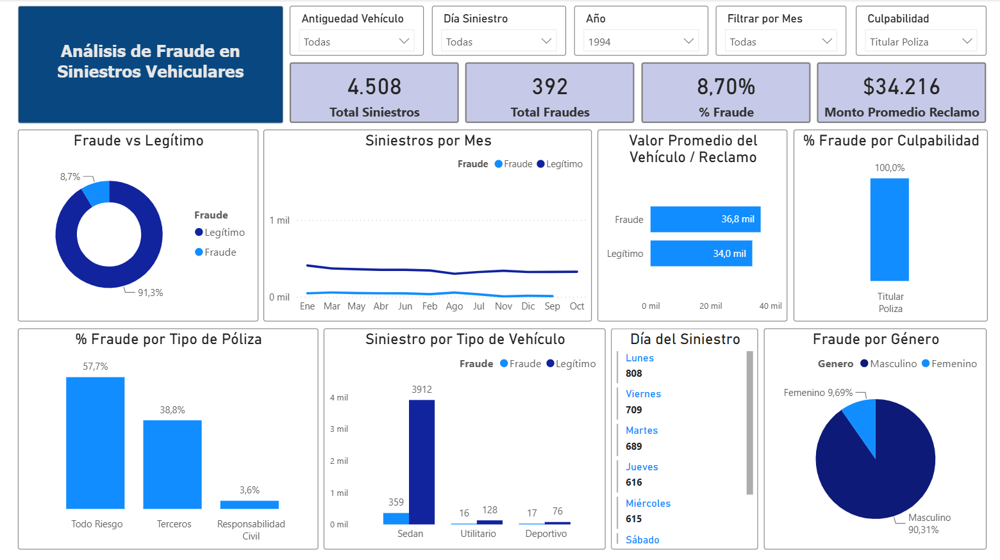

# 🚗 Análisis de Fraude en Siniestros Vehiculares

Análisis exploratorio de **15.420 siniestros vehiculares** (1994-1996) para identificar patrones de fraude, con un dashboard interactivo en Power BI.

## 🎯 Objetivo
Detectar qué características se repiten en los siniestros fraudulentos (quién, cuándo, qué vehículo y qué tipo de póliza) para orientar la detección temprana.

## 📊 Dashboard en Power BI

*Vista general: 15.420 siniestros, 923 fraudes (5,99 %) y monto promedio de reclamo de USD 33.334.*

*Ejemplo con filtros aplicados (año 1994, culpabilidad "titular de la póliza"): el porcentaje de fraude sube a 8,70 %.*

El dashboard es interactivo: se puede filtrar por antigüedad del vehículo, día, año, mes y culpabilidad. Para explorarlo, descargá `Análisis de Fraude en Siniestros Vehiculares.pbix` y abrilo con **Power BI Desktop**.

## 🛠️ Herramientas utilizadas
- **Python** (pandas, matplotlib, seaborn) para limpiar y analizar los datos
- **Jupyter Notebook**
- **Power BI** para el dashboard

## 🔍 Conclusiones principales

### Perfil del fraude
- Solo el **5,99 %** de los siniestros fueron clasificados como fraude.
- El **96 %** de los fraudes son atribuidos al titular de la póliza.
- El **88,62 %** de los fraudes son cometidos por conductores masculinos.
- Los lunes concentran la mayor cantidad de siniestros (2.616 en total).

### Patrones por vehículo y póliza
- Los vehículos **Sedan** concentran la mayor cantidad de siniestros.
- El **49 %** de los fraudes ocurren en pólizas de **Todo Riesgo**.
- Los vehículos fraudulentos tienen un valor promedio ligeramente superior al de los siniestros legítimos (USD 35,5 mil frente a 33,2 mil).

### Insights para el negocio
- Los perfiles de mayor riesgo combinan: conductor masculino, titular de la póliza, vehículo Sedan y cobertura Todo Riesgo.
- La detección temprana en este segmento podría reducir las pérdidas por fraude.

## 📁 Archivos
| Archivo | Descripción |
|---|---|
| `analisis_siniestros_seguros_v2 (1).ipynb` | Notebook con la limpieza y el análisis en Python |
| `datos_limpios_para_powerbi.csv` | Dataset limpio y transformado, usado en el dashboard |
| `Análisis de Fraude en Siniestros Vehiculares.pbix` | Dashboard de Power BI (se abre con Power BI Desktop) |
| `grafico_01...` a `grafico_06...` | Gráficos generados con matplotlib y seaborn |

## ▶️ Cómo reproducirlo
1. Descargá el dataset original `fraud_oracle.csv` desde Kaggle (ver más abajo) y dejalo junto al notebook.
2. Instalá las librerías: `pip install pandas numpy matplotlib seaborn jupyter`.
3. Abrí el notebook y ejecutalo completo.

## 📂 Dataset
**Vehicle Insurance Claim Fraud Detection**, disponible en Kaggle.

## 👩‍💻 Autora
Carla Maguiña

